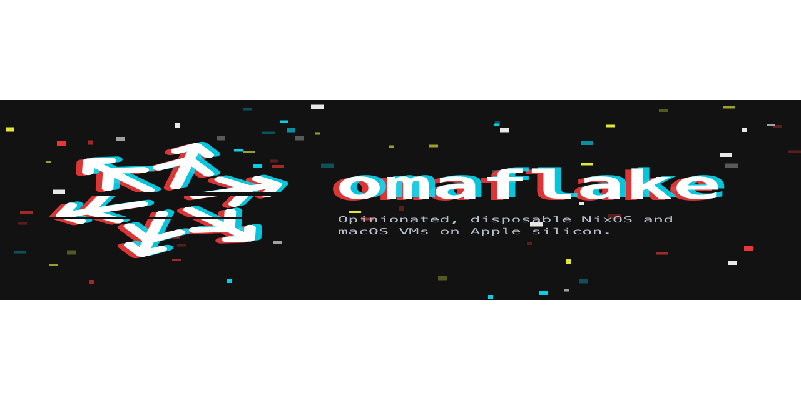

  

**Clean, disposable NixOS and macOS virtual machines on Apple silicon – one click away.**

omaflake builds VM templates from **recipes** you declare in Nix and runs disposable VMs from them – from a menu bar
app or the `omaf` CLI. Templates never change: *reset* throws a VM's state away and starts over.

- **Two guest kinds:** NixOS on QEMU (3D with virglrenderer) and macOS on Virtualization.framework – the macOS base is
  installed from Apple's restore image without manual steps.
- **Recipes from sources:** the official catalog, other GitHub repositories (also private), or a local folder – share
  recipes, not machines.
- **Integrated:** sound and microphone, shared clipboard with text and images, the Mac's camera in NixOS guests,
  shared folders, dynamic resolution, ephemeral VMs.
- **Portable:** export VMs, templates and recipes as packages to an external disk and back, or run a VM from there.
- **Doctor:** checks what the Mac brings and sets up Nix, nix-darwin and the Linux builder by click.

| Repository | What |
|---|---|
| [omaflake](https://github.com/omaflake/omaflake) | the app, the `omaf` CLI, the macOS runner, the patched QEMU and the image flake |
| [recipes](https://github.com/omaflake/recipes) | the official recipe catalog – and the template for your own recipe source |
| [website](https://github.com/omaflake/website) | omaflake's landing page |

> **Status:** alpha, unsigned – download at [omaflake.app](https://omaflake.app). Needs a Mac with Apple silicon and macOS 27.

omaflake is free software (AGPL-3.0-or-later; its recipes MIT) and a project of <a href="https://falkoss.org">falkOSS</a> – Falcon Lake Open Source Software gUG (haftungsbeschränkt) i. G., from Falkensee.
